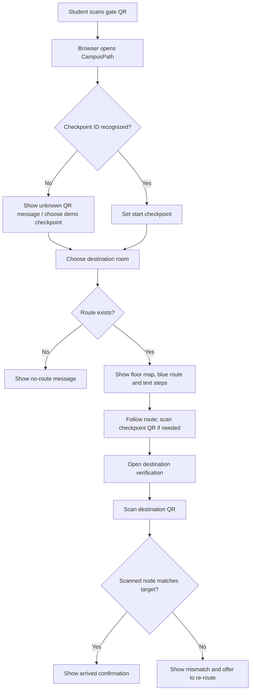

# APP_FLOW — CampusPath

## Main navigation flow

## Screens and states
1. **Home / Start checkpoint** — current checkpoint, QR scanner action, demo checkpoint selector.
2. **Destination selection** — room dropdown/search; accessibility preference.
3. **Route view** — route summary, per-floor schematic/real map, blue line, directions, floor transitions.
4. **Checkpoint update** — scanning a known checkpoint changes the start node; user should request a fresh route if needed.
5. **Destination verification** — scan a QR or open a verification URL; compare scanned node ID with intended target.
6. **Error states** — camera denied/unavailable, malformed QR, unknown node, unreachable destination, target mismatch.

## URL contract
- Start checkpoint: `/?node=GATE`
- Optional intermediate checkpoint: `/?node=F1_STAIRS`
- Destination verification: `/verify?target=F1_S34`
- Destination QR may encode `/verify?target=F1_S34&node=F1_S34` or another documented stable-node URL format.
- Use permanent node IDs in QR codes; do not encode mutable display names as the source of truth.

## Interaction rules
- Camera is started only after the user presses the scan button.
- A valid checkpoint updates the known position only at scan time; it does not animate a live position between scans.
- Verification succeeds only when the scanned node matches the selected target.
- A mismatch must clearly identify the mismatch and avoid falsely showing success.
- For real data, add a “scan nearest checkpoint / update my location” action at key junctions.
